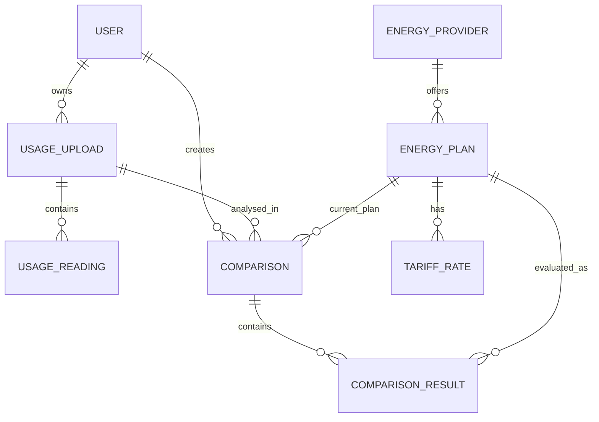

# Entity Relationship Diagram

## Main relationships
- One user can own many uploads.
- One upload can contain many interval readings.
- One provider can have many plans.
- One plan can have one or more tariff rates.
- One comparison uses one uploaded usage dataset and can optionally identify a current plan.
- One comparison contains a result for each successfully evaluated active plan.
